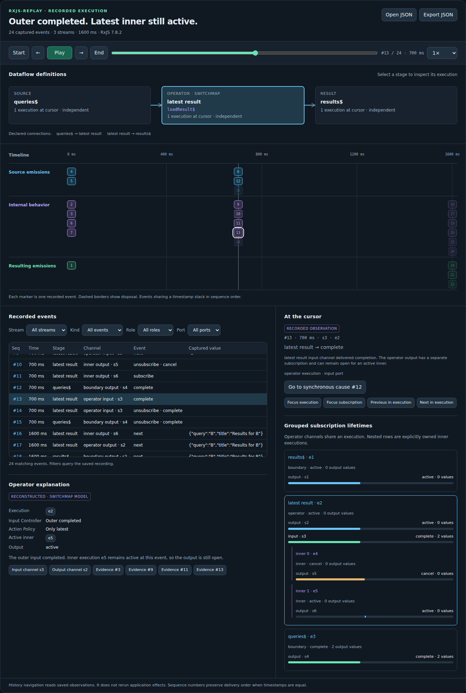

# rxjs-replay

**Record an RxJS execution, explain its operator behavior, and replay captured notifications with explicit time and cancellation.**

`rxjs-replay` is a TypeScript library for **RxJS 7.8.2**. Place a `trace()` operator at the stream boundaries you want to observe. After the application runs, inspect the recording, move through it, ask new questions about captured values, or use recorded inputs in a regression test.

The implementation uses functions and closures. The core runs without a DOM; an optional browser viewer links a selectable dataflow graph, four aligned lanes, operator explanations, and grouped subscription lifetimes.

**New in 0.2:** instrumented `switchMap`, separate input/output channels grouped by execution, pure operator analysis, and synchronized graph/lifetime navigation. New recordings use schema version 2. Existing version 1 recordings still open and replay unchanged.



## Run the project

Requires Node.js **22.18 or later**.

```bash
git clone https://github.com/hansschenker/rxjs-replay.git
cd rxjs-replay
npm install
npm run check
npm run example
npm run demo
```

Open [http://127.0.0.1:4173](http://127.0.0.1:4173) for the local viewer. The demo includes recordings of `switchMap` cancellation and a `scan` accumulator, generated using real RxJS sources and a `VirtualTimeScheduler`.

`npm run demo:build` builds the static demo. `npm run build` builds the library.

## Install from GitHub

The package is **not published to the npm registry**. Install it directly from this repository:

```bash
npm install rxjs@7.8.2 github:hansschenker/rxjs-replay
```

For repeatable builds, append `#<commit-sha>` to the GitHub dependency. Import the installed package as `@hansschenker/rxjs-replay`.

## What you can do

| Operation | Meaning |
| --- | --- |
| Record | Observe explicitly instrumented notifications, subscription lifetimes, and supplied state snapshots. |
| Inspect | Reconstruct what the retained history shows at a particular event. |
| Explain | Inspect supported `switchMap` state and event explanations derived from recorded facts. |
| Navigate | Seek, step, play, pause, and change playback speed over recorded history. |
| Query | Filter recorded events and evaluate new projections over their captured data. |
| Replay events | Deliver trace records as a cold Observable. |
| Replay a subscription | Deliver captured `next`, `error`, completion, and cancellation behavior on a supplied scheduler. |
| View | Link declared graph stages, operator executions, inner lifetimes, and the four-lane timeline. |

The recording contains detached data from selected stream boundaries. It does not contain the browser VM, arbitrary local variables, or unrecorded application state. Navigation and historical queries do not subscribe to the original application or repeat its effects.

## Record a dataflow

First describe the stream boundaries and their relationship. Then place `trace()` in the dataflow. Recording begins when an application subscriber connects.

```ts
import { map, of } from 'rxjs';
import { createRecorder } from '@hansschenker/rxjs-replay';

const double = (value: number): number => value * 2;

const recorder = createRecorder({
  name: 'Double a sequence',
  streams: [
    { id: 'numbers', label: 'Numbers', lane: 'source', sharing: 'independent' },
    { id: 'doubled', label: 'Doubled', lane: 'result', inputs: ['numbers'] },
  ],
});

const doubled$ = of(2, 4, 6).pipe(
  recorder.trace<number>('numbers'),
  map(double),
  recorder.trace<number>('doubled'),
);

// The dataflow is described; there are no recorded events yet.
console.log(recorder.getRecording().events.length); // 0

const subscription = doubled$.subscribe(console.log); // 4, 8, 12
const recording = recorder.getRecording();

// This synchronous example has already completed.
console.log(subscription.closed); // true
```

`trace()` adds no application subscription of its own and does not introduce sharing. An emitted package continues through the original dataflow. The recorder captures a detached representation for later inspection.

### The events that are recorded

| Event | What was observed |
| --- | --- |
| `subscribe` | A subscription entered an instrumented boundary. |
| `next` | A value was delivered at that boundary. |
| `error` | An error notification was delivered. |
| `complete` | A completion notification was delivered. |
| `unsubscribe` | That boundary's subscription was disposed, with reason `cancel`, `complete`, or `error`. |
| `state` | A `captureState` function explicitly supplied a domain-state snapshot. |

Completion, error, and disposal are distinct observations. Explicit unsubscription does not invent a completion notification.

### Capture domain state explicitly

`trace<T>(streamId, { captureState, stateLabel })` can record state carried by emitted values. Use it after a stateful domain pipeline, for example after `scan`.

The application pattern **`scan` + `shareReplay({ bufferSize: 1, refCount: true })`** creates an explicitly shared state stream that remembers its latest value while connected. Decide where to place `trace()` relative to sharing according to the boundary you want to observe.

`captureState` does not expose RxJS private operator state. Domain meaning stays in your named functions; operators determine how packages move over time.

## Explain an operator execution

When a new query arrives, `switchMap` replaces its previous inner subscription. When the query source completes, the output waits for any remaining inner execution. `recorder.switchMap()` observes that behavior by delegating to RxJS 7.8.2's real operator. Your named function still provides the domain operation.

Declare the operator and domain function, then use the adapter in the dataflow:

```ts
import { Subject, type Observable } from 'rxjs';
import { createRecorder, getExecutions, getSwitchMapState } from '@hansschenker/rxjs-replay';

interface SearchResult { readonly query: string; readonly title: string }
declare function loadResult$(query: string): Observable<SearchResult>;
declare function renderResult(result: SearchResult): void;

const recorder = createRecorder({
  name: 'Latest search',
  streams: [
    { id: 'queries', label: 'queries$', lane: 'source', sharing: 'live' },
    {
      id: 'latest', label: 'Latest result', lane: 'internal', inputs: ['queries'],
      operator: 'switchMap', domain: 'loadResult$',
    },
    { id: 'results', label: 'results$', lane: 'result', inputs: ['latest'] },
  ],
});
const queries$ = new Subject<string>(); // Explicit live input.
const results$ = queries$.pipe(
  recorder.trace<string>('queries'),
  recorder.switchMap('latest', loadResult$),
  recorder.trace<SearchResult>('results'),
);

// The application owns execution and disposal.
const subscription = results$.subscribe({ next: renderResult });
queries$.next('rxjs');
queries$.next('rxjs cancellation');
queries$.complete();

const recording = recorder.getRecording();
const operator = getExecutions(recording).find(item => item.role === 'operator');
if (operator) console.log(getSwitchMapState(recording, operator.id));

// At the application's normal disposal boundary:
subscription.unsubscribe();
```

Every operator execution has an `executionId`. Its input and output use **different `subscriptionId` values**, so an input completion cannot prematurely complete output replay. Each inner has its own execution and subscription, an `ownerExecutionId`, and its original projection `innerIndex`. Ordinary `parentSubscriptionId` still means observed synchronous nesting; it is not operator ownership.

Use `getExecutions(recording, seq?)` for cursor-scoped groups, `getSwitchMapState(recording, executionId, seq?)` for the supported operator model, and `explainEvent(recording, event)` for an event description. Results distinguish **recorded evidence**, **reconstructed explanations**, and **unavailable state**. Reentrant overlap beyond the supported single-active-inner model is unavailable; its actual events remain inspectable. Terminal notifications and the later observed disposal are kept separate.

The adapter stays lazy, adds no application subscription or sharing, and preserves live value/error identity. A plain `trace()` on a stage labelled `switchMap` remains a boundary probe; labels alone do not create operator observations. See [Operator inspection](docs/OPERATOR_INSPECTION.md) for the model, cursor semantics, and examples.

## Time, cancellation, and sharing

**Time comes from a clock.** The default recorder clock uses `performance.now()`. Recorded `at` values are nonnegative milliseconds relative to recorder creation. Supply a virtual clock when capturing a deterministic scenario:

```ts
const recorder = createRecorder({
  name: 'Virtual execution',
  streams: [{ id: 'input', label: 'Input', lane: 'source' }],
  clock: { name: 'virtual', now: () => testScheduler.now() },
});
```

Every event also has a strictly increasing `seq`. **`seq` is the delivery-order authority.** Two events can share the same timestamp and still have a defined order. Clock failures and backward readings are counted in `capture.clockErrors`; timestamps are clamped rather than used to reorder events.

**Cancellation remains explicit.** Disposing a live application subscription records disposal. Calling `recorder.stop()` stops capture and returns a final snapshot; the application continues with its ordinary subscription lifecycle. Stopping capture does not manufacture terminal events.

**Sharing remains an application decision.** A trace before `share()` observes upstream connections. A trace after `share()` observes each downstream subscription at that boundary. The `sharing` field in stream metadata is descriptive; it does not execute a sharing operator or infer sharing from similar values.

## Inspect and query history

```ts
import {
  evaluateLogpoint,
  inspectAt,
  selectEvents,
  type TraceEvent,
} from '@hansschenker/rxjs-replay';

const resultValues = selectEvents(recording, {
  streamId: 'doubled',
  kinds: ['next'],
});

const view = inspectAt(recording, resultValues[0]?.seq ?? 0);

const describeValue = (event: TraceEvent) =>
  event.kind === 'next' ? event.value : null;

const logpoints = evaluateLogpoint(
  recording,
  { streamId: 'doubled', kinds: ['next'] },
  describeValue,
);
```

`selectEvents()` supports stream, subscription, execution, owner, role, port, event-kind, sequence-range, and time-range filters. `inspectAt()` reconstructs the subscriptions, counts, and latest captured values/state visible through a cursor position. Cursor `0` means before the first event.

A retrospective logpoint applies a user function to captured events. Each result contains its source event and either a successful value or an error description. Keep these functions pure. They cannot read local variables that were never captured, and they do not execute inside a historical JavaScript frame.

## Navigate a recording

```ts
import { createReplay } from '@hansschenker/rxjs-replay';

const replay = createReplay(recording);
const observation = replay.state$.subscribe(console.log);

replay.step();             // Next retained event.
replay.step(-1);           // Previous retained event.
replay.seek(0);            // Before the first event.
replay.seekTime(10, 'before');
replay.setSpeed(2);
replay.play();
replay.pause();

observation.unsubscribe();
replay.dispose();
```

The controller owns one explicitly shared state lifetime. `state$` gives observers the same history position and late observers the current state. Seek and step stop playback, producing `paused` or `ended` at the selected position. `ended` means the end of the retained history, not completion of the original application. `seekTime(at, 'before')` selects the last event at or before the time; `'after'` selects the first at or after it, clamping to the retained end when the requested time is beyond history. Sequence order resolves events at equal times.

Pause/resume and speed changes preserve the portion of a wait that has already elapsed. Playback schedules work through the supplied `PlaybackOptions.scheduler`; it never relies on the timing of rendering. Call `dispose()` to release controller work when its owner is finished.

## Replay notifications as streams

`replayEvents(recording, options)` is a cold `Observable<TraceEvent>`. Each subscriber gets an independent scheduled traversal. A recorded `error` is an ordinary trace value in this stream. It completes at the end of the retained trace.

`replaySubscription(recording, subscriptionId, options)` replays a single recorded subscription. Its timing starts at that subscription's recorded start time:

- Captured `next` values become `next` notifications.
- A captured error becomes an error notification; its default value is the stored JSON representation.
- A recorded completion becomes completion.
- A recorded cancellation closes the replay subscription without inventing completion.
- A retained prefix with no observed ending stays open after its last event. The consumer can unsubscribe explicitly.

Without a decoder, fully captured values are delivered as their JSON-safe representation. Supply `decodeValue` for domain objects or special values and `decodeError` for domain error reconstruction. Original object identity and error prototypes cannot be restored from a snapshot. Truncated or unavailable payloads require an explicit decoder or fail rather than silently pretending to be the original value.

Unsubscribing from a replay stops its scheduled deliveries. It has no effect on the already recorded application.

### Use a recorded input in a regression test

This example captures an input scenario, then feeds its replay through the current processing function. The test checks processing against recorded inputs, rather than merely comparing a recording with itself.

```ts
import assert from 'node:assert/strict';
import { map } from 'rxjs';
import { TestScheduler } from 'rxjs/testing';
import {
  createRecorder,
  replaySubscription,
  type CapturedValue,
} from '@hansschenker/rxjs-replay';

const equal = (actual: unknown, expected: unknown) =>
  assert.deepEqual(actual, expected);
const captureClock = new TestScheduler(equal);
const recorder = createRecorder({
  name: 'Recorded numeric input',
  streams: [{ id: 'input', label: 'Input', lane: 'source' }],
  clock: { name: 'virtual', now: () => captureClock.now() },
});

captureClock.run(({ cold }) => {
  cold('a--b--|', { a: 2, b: 4 })
    .pipe(recorder.trace<number>('input'))
    .subscribe();
});

const recording = recorder.stop();
const start = recording.events.find(event => event.kind === 'subscribe')!;
const decodeNumber = (value: CapturedValue): number => {
  if (value.status !== 'captured' || typeof value.data !== 'number') {
    throw new TypeError('Expected a fully captured number');
  }
  return value.data;
};
const double = (value: number): number => value * 2;

const replayClock = new TestScheduler(equal);
replayClock.run(({ expectObservable }) => {
  const input$ = replaySubscription(recording, start.subscriptionId, {
    scheduler: replayClock,
    decodeValue: decodeNumber,
  });
  expectObservable(input$.pipe(map(double))).toBe('a--b--|', { a: 4, b: 8 });
});
```

For a pipeline with asynchronous dependencies, provide deterministic substitutes for those dependencies and inject the relevant schedulers. Replaying captured inputs does not automatically control a new network request, random number, or external clock introduced by the tested pipeline.

## Optional four-lane viewer

```ts
import { mountReplay } from '@hansschenker/rxjs-replay/viewer';

const element = document.querySelector<HTMLElement>('#replay')!;
const viewer = mountReplay(element, recording);

// Replace the inspected recording when needed:
viewer.setRecording(anotherRecording);

// When the owning UI is removed:
viewer.destroy();
```

The aligned lanes are **Timeline**, **Source emissions**, **Internal behavior**, and **Resulting emissions**. A selectable graph shows declared connections and separate operator/domain labels. The event panel distinguishes captured facts from reconstructed operator explanations, with links to the supporting events. Grouped lifetimes expose separate input/output channels and owned inners at the current cursor.

Controls include play/pause, stepping, beginning/end navigation, position and speed controls, stage/subscription/notification filters, and JSON import/export. Stage, execution, inner, and cause selections coordinate with the same cursor. Imported data is rendered as text. Large recordings use bounded event lists to keep the display usable.

## Save, import, and bound capture

```ts
import { parseRecording, serializeRecording } from '@hansschenker/rxjs-replay';

const json = serializeRecording(recording, 2);
const imported = parseRecording(json);
```

Imports are validated and deeply frozen. Export validates the recording as well. `parseRecording()` accepts Replay schema versions 1 and 2; version 1 stays unchanged and its operator explanations are unavailable because that evidence was not recorded. New recorders emit version 2. `captureSnapshot(value, projection?)` is also exported when a caller needs the same detached value representation outside `trace()`. See [Trace format](docs/TRACE_FORMAT.md).

`maxEvents` defaults to **50,000**, with a maximum of **250,000**. Once the limit is reached, the recorder retains the original prefix and counts omitted suffix events in `capture.droppedEvents`. It does not rotate the buffer or overwrite the beginning. `capture.totalEvents` counts observed events while capture was active, including those omitted from storage.

A missing terminal event in a truncated or stopped recording means its outcome is unknown. An `active` subscription in an inspected history means no ending has been observed through that cursor. It is not proof that the original subscription is still running or leaking.

`captureValue` lets you project or redact values before capture. Capture functions must remain pure: do not emit, subscribe, mutate, or perform application effects inside them.

The snapshotter avoids ordinary getters and `toJSON`, and bounds depth, entries, and string previews. Inspecting a JavaScript Proxy can still invoke its traps. JSON exchange is limited to 32 Mi characters; the viewer's file picker accepts up to 20 MiB. Use a small capture projection for large application payloads.

## Design and scope

- [Architecture and the Input Controller / Action Policy model](docs/ARCHITECTURE.md)
- [Trace format, ordering, and lifecycle semantics](docs/TRACE_FORMAT.md)
- [Operator inspection, supported explanations, and linked navigation](docs/OPERATOR_INSPECTION.md)
- [Replay source inspiration and the boundaries of this implementation](docs/INSPIRATION.md)
- [Roadmap](docs/ROADMAP.md)

The public core API is exported from the package root. DOM rendering is isolated in the optional `/viewer` entry point. RxJS **7.8.2** is the supported baseline. The project uses no global RxJS patches and makes no claim to record the entire JavaScript runtime.

## Contributors

**GPT-6 Astra is the main contributor to this project.**

Created in collaboration with [Hans Schenker](https://github.com/hansschenker), who provides the project direction and RxJS teaching context. Replay's public work informed the investigation; this is an independent implementation with no affiliation to Replay.io.

## License

[MIT](LICENSE) — Copyright 2026 Hans Schenker and contributors.
