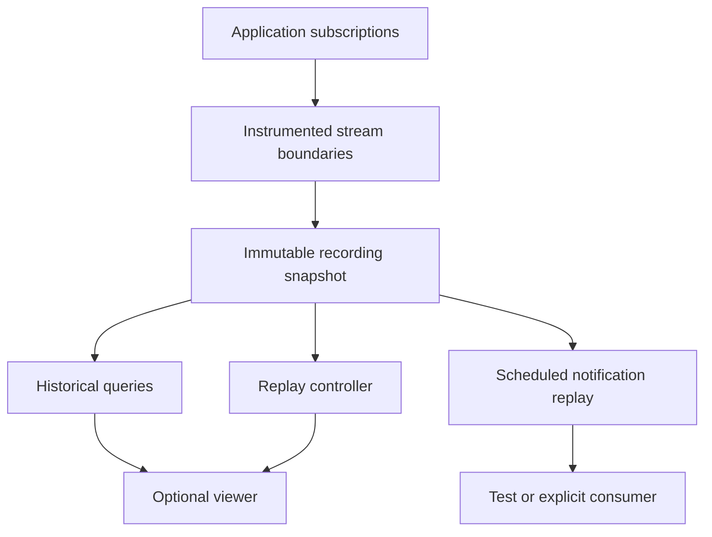

# Architecture

## The unit of history is an observed stream event

An Observable describes a dataflow. `createRecorder()` configures observation; placing `trace()` in a pipeline describes where observation will happen. The application subscriber initiates execution. Instrumentation adds no independent application subscription.

A recording contains observations from those explicit boundaries: subscriptions, notification delivery, disposal, and domain-state snapshots supplied by the application. It is not a capture of every machine instruction or every operator's private state.

The main separation is between a running application and detached recorded history:

Inspecting the recording has no connection back to the original source. An application may deliberately subscribe to replayed notifications and attach effects; that is a new execution owned by that application.

## Recording responsibilities

`createRecorder()` owns a recording session, stream definitions, a clock origin, a sequence counter, execution/subscription identifiers, and the retained prefix of events. Its `trace()` operator observes each connection at the named boundary. Its `switchMap()` adapter delegates to RxJS's actual policy while observing input, output, and inner connections.

The instrumentation preserves live notification identity and ordinary RxJS subscription ownership. The stored representation is detached. Capturing an `Error` for inspection does not replace the error object delivered through the live pipeline.

### Execution groups and replayable channels

Schema version 2 separates execution identity from subscription identity. An operator's input and output share an `executionId`, but each has its own `subscriptionId`. Inner executions carry explicit `ownerExecutionId` metadata. This allows an input to complete while the output continues, without weakening the single-subscription notification protocol or changing notification replay.

The adapter invokes the domain projector at RxJS's own projection point and converts its returned `ObservableInput` there. Reentrant input is preserved. If projection has already closed the inner destination, the returned Observable still receives the closed subscriber as it does in RxJS, preserving source setup/teardown without fabricating an active inner lifecycle.

Forwarding subscribers are attached to their destinations before upstream begins. Synchronous `take(1)` or explicit disposal therefore closes the source immediately. The adapter keeps completion/error notifications separate from observed subscription disposal.

Existing Replay schema version 1 is validated and kept unchanged. Analysis can show its individual subscriptions as boundary groups; it cannot infer operator roles or ownership that were never captured.

### Ordering

Each observed event receives a strictly increasing `seq`. This counter defines the order in which the recorder observed events across the whole session.

The `at` field is elapsed time from the session's clock origin. The recorder attempts to establish that origin during creation; if the initial clock reading fails, its first valid reading establishes the origin. Equal timestamps are expected for synchronous work and virtual-time frames. Invalid or backward clock readings are clamped and counted. Time never changes recorded sequence order.

`causeSeq` records an observed synchronous delivery context when one exists. It is useful for following nested work, but does not establish complete asynchronous causality. Similarly, a parent subscription identifier describes observed nesting; it is not a proof of every dependency in the application.

### Captured values

Values are converted to JSON-safe snapshots with a visible capture status. The optional `captureValue` function projects or redacts packages before capture. `captureState` explicitly extracts domain state from an emitted value.

Neither hook should emit, subscribe, mutate, or perform effects. A recording can preserve the data a hook supplies; it cannot guarantee the semantics of an impure user function.

### Bounded capture

The recorder preserves the first `maxEvents` events. After the budget is exhausted, it counts the omitted suffix. This policy keeps the beginning of each retained execution available for interpretation and avoids silently presenting a rotating suffix as a complete recording.

Stopping capture leaves the application running. The recorder does not add fictional completion, cancellation, or state events to make the file look finished.

## Historical queries

The query functions operate on immutable captured data:

- `selectEvents` filters events by explicit metadata and ranges.
- `inspectAt` folds the retained prefix through a cursor to derive subscription views.
- `evaluateLogpoint` runs a user predicate/projection on captured events, preserving the source event for each result.
- `getExecutions` groups independent notification channels into recorded executions and their explicitly owned inners.
- `getSwitchMapState` reconstructs the supported operator state at the cursor; `explainEvent` relates an event to its observed context and declared policy.

The derived view remembers the most recently observed values and state for each instrumented subscription. An outcome of `active` means that no ending is visible through the selected cursor. It does not assert that the original resource remains active now.

For a stopped or truncated recording, later activity may be unknown. Analysis should retain that uncertainty rather than infer a future terminal notification.

The operator model observes notification activity separately from disposal. A completed inner followed by its disposal is one ended inner, not two endings. Output termination can be visible before inner cleanup at an intermediate cursor. Reentrant overlapping inners remain recorded facts but exceed the current single-active-inner model; the explanation becomes unavailable. [Operator inspection](OPERATOR_INSPECTION.md) documents this boundary.

## Replay controller: Input Controller and Action Policy

The replay controller is a small event-driven machine over **history position**. It does not store or restore the original application's execution state.

### Input Controller

The Input Controller receives commands such as seek, step, play, pause, speed change, and dispose. Scheduled playback contributes tick commands. These inputs describe what should happen to the position in the retained recording.

The controller's remembered state is:

| State field | Meaning |
| --- | --- |
| `cursor` | `0` before history, otherwise a retained event sequence. |
| `status` | `paused`, `playing`, `ended`, or `disposed`. `ended` refers to the retained history. |
| `speed` | The selected positive playback speed. |

### Action Policy

The Action Policy determines observable consequences: publish the new cursor state, arrange the next scheduled advance, cancel pending playback, or release controller resources.

| Input | Intended consequence |
| --- | --- |
| Seek or step | Stop playback and select a position in retained history; report `ended` at its end. |
| Play | Advance through retained events according to their timing. |
| Pause | Cancel the pending advance and remember elapsed progress. |
| Speed change | Apply a new pacing factor while preserving elapsed progress. |
| Tick | Advance to the scheduled recorded event. |
| Dispose | Release controller-owned scheduled work and state lifetime. |

The state stream follows the pattern **`scan` + `shareReplay(1)`**: a reducer remembers command history, and one explicitly shared state stream exposes the current replay position. The exact sharing configuration and ownership matter: the controller has one lifetime, its observers share one cursor, and its owner calls `dispose()` when finished.

### Formal Mealy correspondence

The teaching model maps to a Mealy-style transition/output description:

- `S` is replay state: cursor, status, speed, together with any private scheduling bookkeeping needed to preserve partial waits.
- `Z` is the input alphabet of commands and scheduled ticks.
- `A` is the alphabet of controller actions; `A*` allows zero or more actions per input.
- `T: S × Z → S` computes the next remembered state.
- `G: S × Z → A*` selects zero or more actions, such as publishing state, scheduling work, or cancelling work.

The **Input Controller** determines which command enters this transition. The **Action Policy** corresponds to `G`; the reducer/state update corresponds to `T`. Scheduler callbacks are inputs to the controller. They are not a source of hidden domain meaning.

This is a semantic decomposition. It does not require one class per machine or a particular state-machine framework. The implementation uses functions, closures, RxJS state composition, and explicit resource ownership.

## Notification replay is a separate operation

Cursor playback tells an inspector which event to display. Notification replay creates an Observable that delivers recorded data to a new subscriber. These operations have different contracts.

### Replay the trace

`replayEvents` emits `TraceEvent` records. A recorded error stays a value in this stream, and the stream completes when the retained trace ends. Unsubscription cancels scheduled deliveries.

### Replay one recorded subscription

`replaySubscription` interprets that subscription's recorded notifications and disposal:

- `next` delivers the captured/decoded value.
- `error` delivers the captured/decoded error.
- `complete` completes.
- Recorded cancellation closes the replay connection without sending completion.
- Missing terminal/disposal evidence leaves the replay open after the retained events.

Scheduling is relative to that subscription's recorded start. A decoder converts a snapshot to the domain type expected by the consumer. Default replay delivers JSON representations; it does not restore object identity, prototypes, or external resources.

Replaying recorded input into a current pipeline is useful for regression tests. Every new asynchronous source and effect used by that pipeline still needs an explicit test policy. A captured HTTP response can be replayed as data; the library does not automatically intercept or reproduce another HTTP request.

## Optional presentation layer

The `/viewer` entry point consumes the core APIs and owns its controller/rendering lifetime. Its four aligned lanes are:

1. **Timeline** — the execution position and time reference.
2. **Source emissions** — events from boundaries declared as `source`.
3. **Internal behavior** — boundaries declared as `internal` and their captured observations.
4. **Resulting emissions** — events from boundaries declared as `result`.

The declared `inputs` graph and `sharing` metadata explain the application author's model. They are not inferred from value equality or the timing of events. Graph stages carry operator/domain labels and coordinate with the selected events. Execution groups show separate input/output lifetimes with explicitly owned inner subscriptions. Operator explanations come from the pure core analysis API and use the same history cursor as the timeline.

Imported values are text. Import does not run recorded code or reconstruct an executable function from a string.

## Invariants

- Observation remains lazy with respect to application subscription.
- Recording and navigation do not add application subscribers or implicit sharing.
- Sequence order survives equal timestamps and synchronous reentrancy.
- Notification completion/error and actual disposal remain distinct.
- Stopping capture does not stop the original application.
- Retained-prefix loss is visible, and absent future events remain unknown.
- Historical inspection does not re-execute application effects.
- The core has no DOM dependency; UI ownership is released explicitly.

See [Trace format](TRACE_FORMAT.md) for the serialized contract and [Inspiration](INSPIRATION.md) for the source-backed design investigation.
